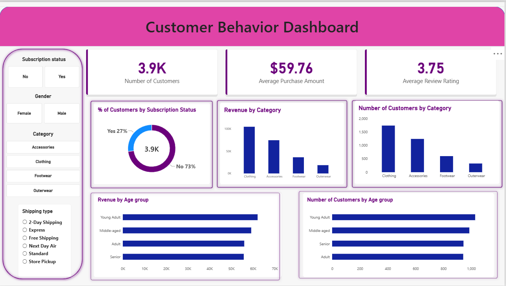

# Customer Shopping Behavior Analysis

An end-to-end data analytics project exploring customer shopping patterns, purchasing behaviour, product performance and revenue insights using Python, PostgreSQL, SQL and Power BI.

## Project Overview

This project analyzes customer shopping behaviour to identify patterns in purchasing decisions, customer segments, subscription preferences, discounts and product performance.

The objective is to transform raw customer data into meaningful business insights that can support data-driven decision-making.

## Business Objectives

- Analyze revenue across customer demographics.
- Understand the relationship between discounts and customer spending.
- Identify highly rated products.
- Compare purchasing behaviour across shipping methods.
- Evaluate subscription patterns and customer spending.
- Segment customers based on previous purchases.
- Build an interactive Power BI dashboard to explore key metrics.

## Tools & Technologies

| Tool | Purpose |
|---|---|
| Python | Data cleaning and exploratory data analysis |
| Pandas | Data manipulation and preprocessing |
| PostgreSQL | Database storage and querying |
| SQL | Business analysis and data extraction |
| Power BI | Interactive dashboard and visualization |

## Project Workflow

1. **Data Loading & Exploration** – Imported the dataset and examined its structure, columns and data types.
2. **Data Cleaning with Python** – Handled missing values, standardized column names, created age groups and derived purchase frequency categories.
3. **Database Setup** – Loaded the cleaned dataset into PostgreSQL.
4. **SQL Analysis** – Answered 10 business questions using aggregation, filtering, CTEs and window functions.
5. **Power BI Dashboard** – Developed an interactive dashboard with KPI cards, charts and slicers.

## Key Findings

- **Customer Revenue:** Female customers contributed $75,191, while male customers contributed $157,890 in the analyzed dataset.
- **Discount Usage:** 839 customers who used discounts spent above the overall average purchase amount.
- **Product Ratings:** Gloves had the highest average review rating among the top five products, at 3.86.
- **Shipping Methods:** Express shipping customers had an average purchase amount of $60.48, compared with $58.46 for Standard shipping.
- **Subscriptions:** 1,053 customers had subscriptions, while 2,847 did not.
- **Customer Segmentation:** The analysis identified 3,116 Loyal, 701 Returning and 83 New customers based on previous purchase counts.
- **Age Groups:** Young Adult customers generated the highest revenue among the four age groups, at $62,143.

## Power BI Dashboard

The interactive dashboard includes:

- Total customer count
- Average purchase amount
- Average review rating
- Customer distribution by subscription status
- Revenue by product category
- Sales by product category
- Revenue by age group
- Customer count by age group

Interactive slicers allow users to explore the data by subscription status, gender, category and shipping type.

## SQL Concepts Demonstrated

- SELECT, WHERE and ORDER BY
- Aggregate functions
- GROUP BY and HAVING
- CASE statements
- Common Table Expressions (CTEs)
- Subqueries
- Window functions
- ROW_NUMBER() with PARTITION BY
- Customer segmentation and business analysis

## Project Limitations

The dataset contains 3,900 customer records, with each row representing a customer's latest purchase. It is a customer-level snapshot rather than a complete transaction history.

Therefore, revenue figures represent the purchase amounts recorded in this dataset and should not be interpreted as lifetime revenue.

The purchase frequency in days is a derived approximation based on frequency categories, not a calculation from actual transaction timestamps.

## Repository Structure

The project files will be organized into the following sections:

- `python/` – Data cleaning and exploratory analysis
- `sql/` – SQL business analysis queries
- `powerbi/` – Power BI dashboard file and screenshots
- `report/` – Final project report

## Conclusion

This project demonstrates an end-to-end data analytics workflow, from data preparation and database management to SQL-based business analysis and interactive visualization.

It helped develop practical skills in Python, Pandas, PostgreSQL, SQL and Power BI while translating customer data into actionable business insights.
